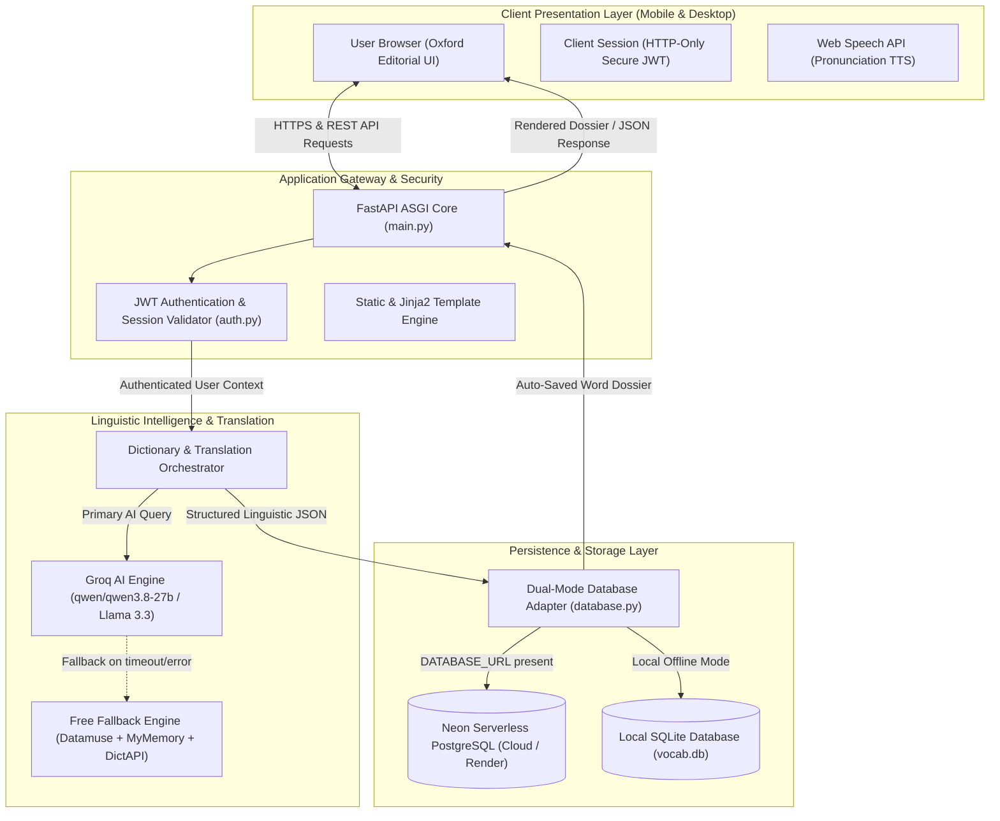
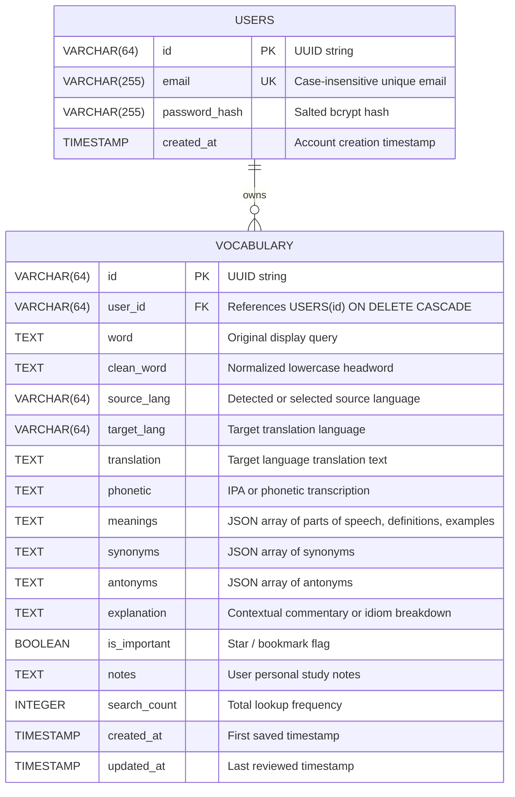
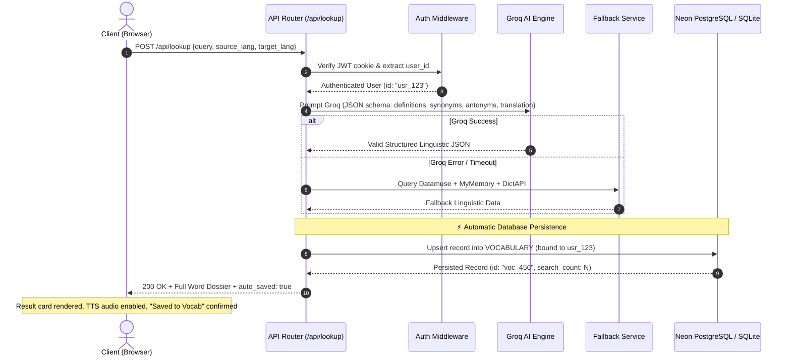

# 📖 LinguaVault — Architectural Specification & System Guide

An enterprise-grade, privacy-first **Multilingual Lexicon & Vocabulary Intelligence Platform** created by **Vedansh**. Built with **FastAPI**, **Neon Serverless PostgreSQL** (with local SQLite fallback), **Groq AI (Llama/Qwen)**, and an **Oxford Editorial** responsive UI.

---

## 🏛️ High-Level System Architecture



---

## 🌟 Core System Capabilities

1. **True Multilingual Lexicon:** Queries definitions, contextual usage examples, phonetic pronunciation guides, synonyms, and antonyms in **any world language**.
2. **Context-Aware Translation:** Real-time translation into user-selected target languages with automatic source-language detection.
3. **Automated Vocabulary Persistence:** Every word, definition, synonym set, and translation is **automatically saved** into the authenticated user's private database.
4. **Deterministic Deduplication & Frequency Tracking:** Subsequent lookups increment an inquiry counter (`search_count`) and refresh the timestamp without duplicate rows.
5. **⭐ Important / Priority Bookmarks:** One-click starring system with dedicated library filters for rapid study and active recall.
6. **Strict Multi-Tenant Isolation:** Zero data overlap between accounts; all database operations strictly filter by `user_id`. Direct URL access to another user's vocabulary returns a secure 404.
7. **Oxford Editorial UI:** Designed with warm archival cream paper palettes (`#FAF7F2`), literary serif typography (*Playfair Display* & *Newsreader*), and responsive mobile ergonomics.

---

## 📂 Component-Level Architecture

```text
transhlation_in_any_language/
│
├── config.py                  # Central configuration registry (Languages, AI models, JWT settings)
├── schemas.py                 # Pydantic data validation & API contract definitions
├── database.py                # Dual-mode ORM/SQL adapter (Neon PostgreSQL & SQLite)
├── auth.py                    # Bcrypt cryptographic hashing & JWT session management
├── main.py                    # ASGI application entrypoint & lifecycle orchestrator
├── requirements.txt           # Pinned production dependencies
├── .env.example               # Sanitized template for environment variables
├── .gitignore                 # Strict ignore rules for secrets, DBs, and virtualenvs
│
├── routers/                   # Modular API & HTML Route Controllers
│   ├── auth_routes.py         # Registration, Authentication, Session lifecycle, Profile stats
│   ├── vocab_routes.py        # Lookup, Auto-save, Vocabulary listing, Star toggle, Notes, Deletion
│   └── page_routes.py         # Server-rendered HTML dashboard, library, and login routes
│
├── services/                  # Linguistic Intelligence & Translation Services
│   ├── groq_service.py        # Groq Llama/Qwen structured multilingual dictionary & Q&A parser
│   ├── fallback_service.py    # Resilience fallback (Free Dictionary API, Datamuse, MyMemory)
│   └── dictionary_manager.py  # Service coordinator managing priority and failover
│
├── static/                    # Frontend Client Assets
│   └── js/
│       ├── app.js             # Global utilities (Toast notification system, Web Speech TTS)
│       ├── search.js          # Search bar controller, card renderer, real-time star toggle
│       ├── vocab.js           # Vault library controller, debounced search, modal dossier
│       └── auth.js            # Authentication tab switcher & AJAX submission handler
│
├── templates/                 # Responsive HTML5 Templates (Tailwind CSS CDN)
│   ├── base.html              # Master layout, navigation bar, active state indicators
│   ├── index.html             # Search, dictionary & translation workspace
│   ├── vocab.html             # Personal vocabulary bank, filter tabs, full detail modal
│   └── auth.html              # Secure Sign-In & Create Account interface
│
└── tests/
    └── test_app.py            # Automated end-to-end integration & privacy test suite
```

---

## 🗄️ Database Schema & Data Models

The persistence layer uses a dual-engine architecture: connecting to **Neon PostgreSQL** in production via PgBouncer pooling, or **SQLite** locally.

### Entity-Relationship Diagram



### Constraints & Indexes
* **Composite Uniqueness:** `UNIQUE(user_id, clean_word, target_lang)` ensures that re-searching an existing word updates review stats rather than creating duplicate entries.
* **`idx_vocab_user`**: Optimizes list queries by user ID.
* **`idx_vocab_important`**: Speeds up filtered views for bookmarked terms.
* **`idx_vocab_word`**: Fast substring and full-text search within personal libraries.

---

## 🔄 Request Lifecycle & Sequence Flow

### Word Lookup & Automatic Persistence Flow



---

## 🔒 Security Architecture & Privacy Guarantee

| Security Measure | Implementation Details |
| :--- | :--- |
| **Password Hashing** | One-way salted `bcrypt` via `passlib`. Plaintext passwords are never logged or stored. |
| **Session Management** | Stateless JSON Web Tokens (JWT) signed with `HS256` and stored in `HttpOnly`, `SameSite=Lax` cookies. |
| **Data Isolation** | Multi-tenant tenant boundaries are enforced at the query level (`WHERE user_id = current_user.id`). |
| **SQL Injection Defense** | 100% parameterized queries via dynamic adapter (`%s` for PostgreSQL, `?` for SQLite). |
| **Credential Safety** | Sensitive API keys and connection strings are managed strictly via environment variables; `.gitignore` blocks `.env` and `*.db`. |

---

## 🌐 API Reference Specifications

### Authentication Endpoints (`/api/auth`)

| Method | Endpoint | Description | Auth Required |
| :--- | :--- | :--- | :--- |
| `POST` | `/api/auth/register` | Register new user account with hashed password | No |
| `POST` | `/api/auth/login` | Authenticate user & issue secure session cookie | No |
| `POST` | `/api/auth/logout` | Invalidate cookie and clear session | Yes |
| `GET` | `/api/auth/me` | Fetch active profile and vocabulary statistics | Yes |

### Vocabulary Endpoints (`/api`)

| Method | Endpoint | Description | Auth Required |
| :--- | :--- | :--- | :--- |
| `POST` | `/api/lookup` | Search word, fetch linguistic dossier & auto-save | Yes |
| `GET` | `/api/vocab` | List user vocabulary with search, filter, and sort | Yes |
| `GET` | `/api/vocab/{id}` | Retrieve comprehensive dossier for a single word | Yes |
| `PATCH`| `/api/vocab/{id}/important` | Toggle ⭐ Important / Bookmarked state | Yes |
| `PATCH`| `/api/vocab/{id}/notes` | Update personal study notes | Yes |
| `DELETE`| `/api/vocab/{id}` | Permanently remove word from collection | Yes |

---

## 🚀 Deployment & Operations

### Cloud Deployment (Render.com + Neon PostgreSQL)

1. **Database:** Host on **Neon.tech** (AWS `us-east-2` with connection pooler `-pooler`).
2. **Web Service:** Host on **Render.com** (Region: `Ohio (US East)`):
   * **Runtime:** `Python 3`
   * **Build Command:** `pip install -r requirements.txt`
   * **Start Command:** `uvicorn main:app --host 0.0.0.0 --port $PORT`
3. **Environment Variables:**
   * `DATABASE_URL`: Connection URL from Neon.
   * `GROQ_API_KEY`: API key from Groq Console.
   * `SECRET_KEY`: Cryptographic signing phrase for JWT tokens.

### Local Development

```powershell
# 1. Install dependencies using uv
uv pip install -r requirements.txt

# 2. Run the application (automatically opens your browser)
python main.py
```

### Running Automated Integration Tests

```powershell
uv run python tests/test_app.py
```

---

## 👨‍💻 Author & Credits

Designed, architected, and built by **Vedansh**.
* **Frontend:** Oxford Editorial System (*Playfair Display*, *Newsreader*, *Plus Jakarta Sans*, Tailwind CSS)
* **Backend:** Python FastAPI & Uvicorn
* **Database:** Neon Serverless PostgreSQL & SQLite3
* **AI:** Groq Llama / Qwen Multilingual Model Architecture
